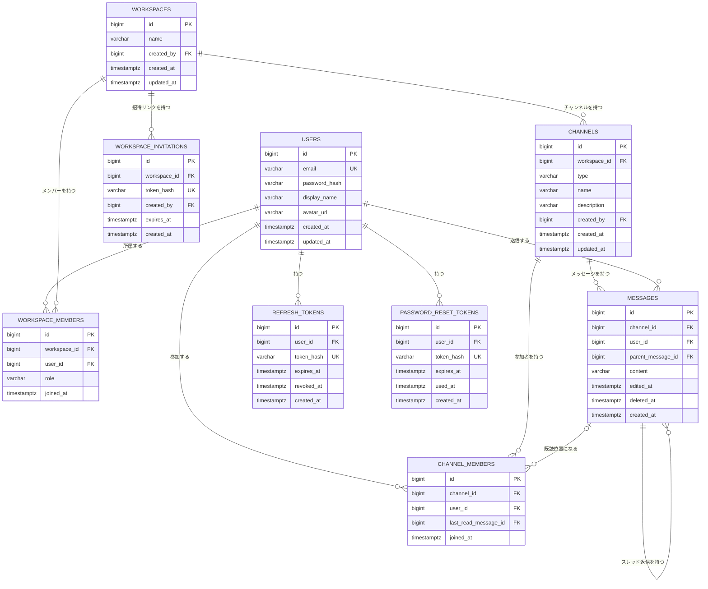

# データベース設計

フェーズ1（MVP）で作るテーブルを定義します。フェーズ2のスレッド・未読・リアクションなどを後から無理なく追加できる形にしています。

## エンティティ一覧

| テーブル | 役割 |
| --- | --- |
| users | アカウント（メールアドレス・パスワード・表示名・アイコン） |
| workspaces | チーム（ワークスペース） |
| workspace_members | 誰がどのワークスペースに所属し、どのロールを持つか |
| workspace_invitations | 招待リンク用のトークン |
| channels | チャンネル。DM（1対1・グループ）もここに含める |
| channel_members | 誰がどのチャンネルに参加しているかと、既読位置 |
| messages | メッセージ本体。スレッド返信もここに含める |
| refresh_tokens | ログイン状態を保つためのリフレッシュトークン |
| password_reset_tokens | パスワードリセット用のトークン |

## 共通方針

- IDはすべて `BIGINT` の自動採番（`GENERATED ALWAYS AS IDENTITY`）とする。IDが登録順に増えるため、カーソル方式のページネーションにそのまま使える
- 日時はすべて `TIMESTAMPTZ`（UTCを正として保存）とする。RaiseTechSNSでは途中で `TIMESTAMP` から変更が必要になったため（V3マイグレーション）、最初から統一する
- トークン類（リフレッシュ・パスワードリセット・招待）は生の値を保存せず、SHA-256ハッシュを保存する。DBの内容が漏れても、トークンをそのまま使われないようにするため
- 列挙値（ロール・チャンネル種別）は `VARCHAR` + `CHECK` 制約で表す。PostgreSQLのENUM型は値の追加・変更の手間が大きいため使わない

## テーブル定義

### users

- id：BIGINT, PK
- email：VARCHAR(255), NOT NULL, UNIQUE（ログインIDとして使う）
- password_hash：VARCHAR(255), NOT NULL
- display_name：VARCHAR(50), NOT NULL
- avatar_url：VARCHAR(500), NULL可（フェーズ2のプロフィール機能で使う）
- created_at：TIMESTAMPTZ, NOT NULL
- updated_at：TIMESTAMPTZ, NOT NULL

### workspaces

- id：BIGINT, PK
- name：VARCHAR(80), NOT NULL
- created_by：BIGINT, FK → users.id, NOT NULL（作成者）
- created_at：TIMESTAMPTZ, NOT NULL
- updated_at：TIMESTAMPTZ, NOT NULL

### workspace_members

- id：BIGINT, PK
- workspace_id：BIGINT, FK → workspaces.id, NOT NULL, ON DELETE CASCADE
- user_id：BIGINT, FK → users.id, NOT NULL
- role：VARCHAR(10), NOT NULL, CHECK (role IN ('OWNER', 'ADMIN', 'MEMBER'))
- joined_at：TIMESTAMPTZ, NOT NULL
- UNIQUE制約：(workspace_id, user_id)（同じワークスペースに2回所属できないようにする）
- ワークスペース作成時に、作成者を `OWNER` として登録する

### workspace_invitations

- id：BIGINT, PK
- workspace_id：BIGINT, FK → workspaces.id, NOT NULL, ON DELETE CASCADE
- token_hash：VARCHAR(255), NOT NULL, UNIQUE
- created_by：BIGINT, FK → users.id, NOT NULL（招待リンクを発行した人）
- expires_at：TIMESTAMPTZ, NOT NULL
- created_at：TIMESTAMPTZ, NOT NULL
- 1つの招待リンクは有効期限内なら複数人が使える（Slackの招待リンクと同じ）

### channels

- id：BIGINT, PK
- workspace_id：BIGINT, FK → workspaces.id, NOT NULL, ON DELETE CASCADE
- type：VARCHAR(10), NOT NULL, CHECK (type IN ('PUBLIC', 'PRIVATE', 'DM'))
- name：VARCHAR(80), NULL可（DMの場合はNULL）
- description：VARCHAR(250), NULL可
- created_by：BIGINT, FK → users.id, NOT NULL
- created_at：TIMESTAMPTZ, NOT NULL
- updated_at：TIMESTAMPTZ, NOT NULL
- CHECK制約：DM以外は name が必須（`type = 'DM' OR name IS NOT NULL`）
- 部分ユニークインデックス：`(workspace_id, name) WHERE type <> 'DM'`（同じワークスペース内でチャンネル名が重複しないようにする。DMは名前を持たないため対象外）
- 同じメンバー構成のDMを重複して作らないチェックは、アプリケーション側で行う

### channel_members

- id：BIGINT, PK
- channel_id：BIGINT, FK → channels.id, NOT NULL, ON DELETE CASCADE
- user_id：BIGINT, FK → users.id, NOT NULL
- last_read_message_id：BIGINT, FK → messages.id, NULL可（最後に読んだメッセージ。NULLは1件も読んでいない状態）
- joined_at：TIMESTAMPTZ, NOT NULL
- UNIQUE制約：(channel_id, user_id)
- 公開チャンネルも「参加」した人だけがここに登録される。非公開チャンネルとDMは、ここに登録された人だけが閲覧できる

### messages

- id：BIGINT, PK
- channel_id：BIGINT, FK → channels.id, NOT NULL, ON DELETE CASCADE
- user_id：BIGINT, FK → users.id, NOT NULL（送信者）
- parent_message_id：BIGINT, FK → messages.id, NULL可（スレッド返信の場合に親メッセージのIDが入る）
- content：VARCHAR(4000), NOT NULL
- edited_at：TIMESTAMPTZ, NULL可（編集された日時。NULLなら未編集）
- deleted_at：TIMESTAMPTZ, NULL可（削除された日時。NULLなら削除されていない）
- created_at：TIMESTAMPTZ, NOT NULL
- インデックス：(channel_id, id)（チャンネルごとのメッセージ一覧・未読数の取得を速くする）
- インデックス：(parent_message_id, id)（スレッド返信の一覧取得を速くする）
- スレッドは1階層のみとし、返信への返信はアプリケーション側で禁止する

### refresh_tokens

- id：BIGINT, PK
- user_id：BIGINT, FK → users.id, NOT NULL
- token_hash：VARCHAR(255), NOT NULL, UNIQUE
- expires_at：TIMESTAMPTZ, NOT NULL
- revoked_at：TIMESTAMPTZ, NULL可（失効済みの場合に日時が入る）
- created_at：TIMESTAMPTZ, NOT NULL

### password_reset_tokens

- id：BIGINT, PK
- user_id：BIGINT, FK → users.id, NOT NULL
- token_hash：VARCHAR(255), NOT NULL, UNIQUE
- expires_at：TIMESTAMPTZ, NOT NULL
- used_at：TIMESTAMPTZ, NULL可（使用済みの場合に日時が入る。同じリンクを2回使えないようにする）
- created_at：TIMESTAMPTZ, NOT NULL

## ER図



## 設計の意図

### ロールは users ではなく workspace_members に持たせる

1人のユーザーが「Aワークスペースでは管理者、Bワークスペースでは一般メンバー」になることがあります。`users.role` にすると1つしか持てないため、表現できません。

ロールはユーザー単体の性質ではなく、「ユーザーとワークスペースの関係」の性質です。そのため、両者をつなぐ中間テーブル `workspace_members` に置いています。

### DMは別テーブルにせず、channelsの一種にする

1対1のDMもグループDMも、「参加者が限られたチャンネル」（`type = 'DM'`）として扱います。メッセージ送信・リアルタイム配信・未読・スレッドの仕組みを、チャンネルとDMで共通化できます。DMを別テーブルにすると、同じ処理を2回書くことになります。

DMには名前がないため `name` はNULL可とし、チャンネル名の重複禁止はDM以外の行にだけ効く部分ユニークインデックスで実現しています。

### 未読は「どこまで読んだか」を1つのIDで持つ

`channel_members.last_read_message_id` に最後に読んだメッセージのIDを保存し、それより新しいメッセージの件数を未読数とします。

```sql
SELECT COUNT(*) FROM messages
WHERE channel_id = :channelId
  AND id > COALESCE(:lastReadMessageId, 0)
  AND parent_message_id IS NULL
  AND deleted_at IS NULL
```

「メッセージごと×ユーザーごとに既読フラグを持つ」方法は採用しません。100人のチャンネルに1万件のメッセージがあると100万行になってしまうためです。チャットは基本的に上から順に読むので、本の「しおり」のように位置を1つ持つだけで足ります。

### スレッドは messages の自己参照で表す

`messages.parent_message_id` がNULLならチャンネルへの投稿、値が入っていればそのメッセージへのスレッド返信です。テーブルが自分自身を参照するこの形を「自己参照」と呼びます。

スレッド機能はフェーズ2ですが、列はフェーズ1から用意します。メッセージ一覧や未読数のSQLを最初から「親メッセージだけ」を前提に書けるため、後から機能を足すときの手戻りが少なくなります。

### メッセージの削除は論理削除にする

メッセージを削除しても行は消さず、`deleted_at` に日時を入れて本文を空にします。画面には「このメッセージは削除されました」と表示します。

スレッドの親メッセージを物理削除すると、返信の参照先がなくなってしまうためです。RaiseTechSNSでは投稿を物理削除（`ON DELETE CASCADE`）していましたが、チャットでは会話の流れを壊さないことを優先しています。

### メッセージ一覧はカーソル方式で取得する

過去メッセージの無限スクロールは、RaiseTechSNSと同じカーソル方式にします。「このIDより古いものを50件」という取り方です。

```sql
SELECT * FROM messages
WHERE channel_id = :channelId
  AND parent_message_id IS NULL
  AND id < :cursor
ORDER BY id DESC
LIMIT 50
```

この検索を速くするため、`messages(channel_id, id)` に複合インデックスを張っています。

## フェーズ2以降で追加予定のテーブル

- reactions：id, message_id, user_id, emoji, created_at / UNIQUE(message_id, user_id, emoji)
- message_attachments：id, message_id, file_url, file_name, content_type, size_bytes, created_at
- Incoming Webhook・Bot連携用のテーブルは、フェーズ3の設計時に定義する
