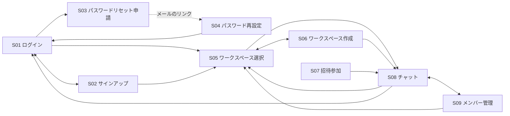

# 画面設計

フェーズ1（MVP）の画面を定義します。画面の見た目と遷移は、[画面デモ](screen-demo.html)をブラウザで開くと実際にクリックして確認できます（ファイルをダウンロードしてダブルクリックで開けます）。

入力欄のチェック（文字数・使える文字など）は、[仕様のルール](specifications.md)の「入力のルール」に従います。

## 画面一覧

| ID | 画面 | 内容 |
| --- | --- | --- |
| S01 | ログイン | メールアドレス・パスワードでログインする。未ログイン時の起点となる画面 |
| S02 | サインアップ | 表示名・メールアドレス・パスワードでアカウントを作成する |
| S03 | パスワードリセット申請 | メールアドレスを入力し、パスワード再設定用のリンクをメールで受け取る |
| S04 | パスワード再設定 | メールのリンクから開き、新しいパスワードを設定する |
| S05 | ワークスペース選択 | 所属しているワークスペースの一覧。ログイン後の起点となる画面 |
| S06 | ワークスペース作成 | 名前を入力してワークスペースを作成する |
| S07 | 招待参加 | 招待リンクから開き、ワークスペースに参加する |
| S08 | チャット | 左にチャンネル・DMの一覧、右にメッセージの一覧と入力欄を表示する、ログイン後のメイン画面 |
| S09 | メンバー管理 | ワークスペースのメンバーとロールの一覧。OWNERはロールの変更とワークスペースの削除ができる |

### チャット画面（S08）上のモーダル

| ID | モーダル | 内容 |
| --- | --- | --- |
| M01 | チャンネル作成 | 名前・説明・公開／非公開を入力してチャンネルを作成する |
| M02 | チャンネルを探す | ワークスペースの公開チャンネルを一覧表示し、参加する |
| M03 | チャンネル詳細 | チャンネルの情報とメンバーの一覧。メンバー追加・非公開化・退出を行う |
| M04 | DM作成 | 相手を1人以上選んでDMを始める |
| M05 | 招待リンク発行 | ワークスペースの招待リンクを発行してコピーする |
| M06 | メッセージ削除の確認 | 自分のメッセージを削除してよいか確認する |

## 画面遷移



- ログイン画面 ⇔ サインアップ画面（未ログイン時に相互に遷移可能）
- ログイン画面 → パスワードリセット申請画面（［パスワードを忘れた方］をクリック）
- パスワードリセット申請画面 → ログイン画面（［ログイン画面に戻る］をクリック）
- メールのリンク → パスワード再設定画面 → ログイン画面（再設定成功時）
- ログイン画面・サインアップ画面 → ワークスペース選択画面（成功時）
- ワークスペース選択画面 ⇔ ワークスペース作成画面
- ワークスペース選択画面 → チャット画面（ワークスペースをクリック）
- ワークスペース作成画面 → チャット画面（作成成功時。`#general` を開く）
- 招待リンク → 招待参加画面 → チャット画面（参加成功時。`#general` を開く）
- 招待参加画面 → ログイン画面・サインアップ画面 → 招待参加画面（未ログイン時。ログイン・サインアップ後に招待参加画面へ戻る）
- チャット画面 ⇔ メンバー管理画面（ワークスペースメニューから）
- チャット画面 → ワークスペース選択画面（ワークスペースメニューの［ワークスペースを切り替える］）
- メンバー管理画面 → ワークスペース選択画面（ワークスペース削除時）
- チャット画面 → ログイン画面（ワークスペースメニューの［ログアウト］）

## 各画面のワイヤーフレーム

### S01 ログイン

```
+--------------------------------+
|         RaiseTechChat           |
+--------------------------------+
|  メールアドレス                  |
|  [_________________________]   |
|                                 |
|  パスワード                     |
|  [_________________________]   |
|                                 |
|           [ ログイン ]           |
|                                 |
|  [パスワードを忘れた方]          |
|  アカウントをお持ちでない方は     |
|  [サインアップ]                 |
+--------------------------------+
```

- メールアドレスまたはパスワードが間違っている場合は「メールアドレスまたはパスワードが正しくありません」と表示する（どちらが間違っているかは表示しない）

### S02 サインアップ

```
+--------------------------------+
|         アカウント作成           |
+--------------------------------+
|  表示名                         |
|  [_________________________]   |
|                                 |
|  メールアドレス                  |
|  [_________________________]   |
|                                 |
|  パスワード（8〜64文字）          |
|  [_________________________]   |
|                                 |
|           [ 登録する ]           |
|                                 |
|  [ログイン画面に戻る]            |
+--------------------------------+
```

- パスワードが8〜64文字でない場合はエラーを表示する
- 登録済みのメールアドレスの場合はエラーを表示する

### S03 パスワードリセット申請

```
+--------------------------------+
|     パスワードの再設定           |
+--------------------------------+
|  登録したメールアドレスに         |
|  再設定用のリンクを送ります       |
|                                 |
|  メールアドレス                  |
|  [_________________________]   |
|                                 |
|          [ 送信する ]            |
|                                 |
|  [ログイン画面に戻る]            |
+--------------------------------+
```

- 送信後は「再設定用のメールを送信しました」と表示する
- 登録されていないメールアドレスでも同じ表示にする（登録の有無を外部に知らせないため）

### S04 パスワード再設定

```
+--------------------------------+
|     新しいパスワードの設定        |
+--------------------------------+
|  新しいパスワード（8〜64文字）    |
|  [_________________________]   |
|                                 |
|  新しいパスワード（確認）         |
|  [_________________________]   |
|                                 |
|          [ 設定する ]            |
+--------------------------------+
```

- 2つの入力が一致しない場合はエラーを表示する
- リンクが期限切れ・使用済みの場合は、フォームの代わりに「このリンクは無効です」と［パスワードリセット申請画面へ］を表示する
- 設定に成功したらログイン画面に戻り、「パスワードを再設定しました」と表示する

### S05 ワークスペース選択

```
+------------------------------------------+
| RaiseTechChat                [ログアウト] |
+------------------------------------------+
| ワークスペースを選択                        |
|                                           |
| [R] RaiseTech 受講生                   >  |
|     メンバー 5人 ・ OWNER                  |
| [個] 個人開発チーム                     >  |
|     メンバー 3人 ・ MEMBER                 |
|                                           |
| [ ＋ ワークスペースを作成 ]                |
+------------------------------------------+
```

- 所属しているワークスペースがない場合は「所属しているワークスペースはありません。作成するか、招待リンクから参加してください」と表示する

### S06 ワークスペース作成

```
+--------------------------------+
|    ワークスペースを作成          |
+--------------------------------+
|  ワークスペース名（80文字まで）   |
|  [_________________________]   |
|                                 |
|     [キャンセル] [ 作成する ]     |
+--------------------------------+
```

- 作成すると、作成者が `OWNER` になり、`#general` チャンネルが自動で作られる

### S07 招待参加

```
+--------------------------------+
|         RaiseTechChat           |
+--------------------------------+
|  佐藤 花子さんから               |
|  「RaiseTech 受講生」への        |
|  招待が届いています              |
|  メンバー 5人                   |
|                                 |
|          [ 参加する ]            |
+--------------------------------+
```

- 参加すると `MEMBER` として登録され、`#general` に自動で参加する
- 未ログインの場合は［参加する］の代わりに［ログインして参加］［アカウントを作成して参加］を表示する
- 有効期限切れのリンクの場合は「この招待リンクは有効期限が切れています」と表示する
- すでに参加済みのワークスペースの場合は、そのままチャット画面を開く

### S08 チャット

```
+-------------------+--------------------------------------------+
| RaiseTech 受講生 ▼ | # general                        [👥 5]    |
+-------------------+--------------------------------------------+
| チャンネル     [+] |      （上にスクロールで過去のメッセージ）      |
|  # general        | [佐] 佐藤 花子  10:02                       |
|  # random     (3) |      今日の勉強会は20時からです               |
|  🔒 dev       (1) | [田] 田中 太郎  10:05            [編集][削除] |
|  チャンネルを探す  |      了解です！（編集済み）                  |
|                   |                                            |
| DM            [+] |                                            |
|  ● 佐藤 花子  (2) +--------------------------------------------+
|  👥 鈴木、高橋     | [#general へのメッセージ              ][送信] |
+-------------------+--------------------------------------------+
```

- サイドバーには、参加しているチャンネルとDMだけを表示する（DMは、自分が作ったものか、メッセージが1件以上あるものだけ）
- 未読があるチャンネル・DMは名前を太字にし、未読件数をバッジで表示する（100件以上は「99+」）。開くと既読になる
- 1対1のDMは相手の名前、グループDMは相手の名前を「、」でつないで表示する
- ワークスペース名をクリックするとメニューを開く：［メンバーを招待］（M05）／［メンバー管理］（S09）／［ワークスペースを切り替える］（S05）／［ログアウト］（S01）
- チャンネル見出しの［+］で M01、［チャンネルを探す］で M02、DM見出しの［+］で M04 を開く
- チャンネル名や［👥 人数］をクリックすると M03 を開く
- メッセージは古い順に表示し、開いたときは最新のメッセージまでスクロールする。一番上までスクロールすると過去のメッセージを読み込む
- 自分のメッセージにだけ［編集］［削除］を表示する
  - ［編集］：その場で入力欄に切り替わる。保存すると「（編集済み）」を表示する
  - ［削除］：M06 で確認してから削除し、画面から消す
- Enterで送信、Shift+Enterで改行する（日本語入力の変換確定のEnterでは送信しない）
- メッセージは4000文字まで。HTMLとして解釈せず、文字のまま表示する（XSS対策）
- 他の人が送ったメッセージはWebSocketでリアルタイムに反映する。開いていないチャンネル・DMに届いた場合は未読バッジを増やす

### S09 メンバー管理

```
+------------------------------------------------------+
| ← チャットに戻る                                       |
+------------------------------------------------------+
| メンバー管理：RaiseTech 受講生                          |
+------------------------------------------------------+
| [田] 田中 太郎（あなた） tanaka@example.com   OWNER      |
| [佐] 佐藤 花子          sato@example.com     ADMIN  [ADMINを解除] |
| [鈴] 鈴木 一郎          suzuki@example.com   MEMBER [ADMINにする] |
+------------------------------------------------------+
| 危険な操作                                              |
| [ ワークスペースを削除 ]                                 |
+------------------------------------------------------+
```

- メンバーの一覧は全員が見られる
- ［ADMINにする］［ADMINを解除］は OWNER にだけ表示する（OWNER自身の行には表示しない）
- ［ワークスペースを削除］は OWNER にだけ表示する。確認のうえ削除し、ワークスペース選択画面に戻る。チャンネル・メッセージもすべて削除される

### M01 チャンネル作成

```
+--------------------------------+
|  チャンネルを作成          [×]  |
+--------------------------------+
|  名前                          |
|  [# ______________________]    |
|  説明（任意）                    |
|  [_________________________]   |
|  (●) 公開：誰でも参加できる      |
|  ( ) 非公開：追加された人だけ     |
|                                 |
|     [キャンセル] [ 作成する ]     |
+--------------------------------+
```

- 同じワークスペース内に同じ名前のチャンネルがある場合はエラーを表示する
- 作成すると作成者が参加した状態になり、そのチャンネルを開く

### M02 チャンネルを探す

```
+------------------------------------+
|  チャンネルを探す              [×]  |
+------------------------------------+
|  # general    全体へのお知らせ        |
|               メンバー 5人   参加済み |
|  # java-質問  Javaの質問はこちら      |
|               メンバー 3人   [参加]  |
+------------------------------------+
```

- ワークスペースの公開チャンネルをすべて表示する。非公開チャンネルは表示しない
- ［参加］を押すとそのチャンネルに参加して開く。参加済みのチャンネルはクリックで開く

### M03 チャンネル詳細

```
+------------------------------------+
|  # random                      [×]  |
+------------------------------------+
|  名前：random                [編集]  |
|  説明：雑談                    [編集]  |
|  種別：公開チャンネル                  |
|                                     |
|  メンバー（4人）                      |
|   [田] 田中 太郎                      |
|   [佐] 佐藤 花子                      |
|   ...                               |
|  [＋ メンバーを追加]  ※非公開のみ      |
|                                     |
|  [非公開にする]  ※OWNER・ADMINのみ    |
|  [チャンネルから退出]                  |
+------------------------------------+
```

- 名前・説明の［編集］は参加者全員に表示する。`#general` は名前の［編集］を表示しない
- 名前を変更するときに、同じワークスペース内に同じ名前のチャンネルがある場合はエラーを表示する
- ［メンバーを追加］は非公開チャンネルにだけ表示する（チャンネルの参加者だけがこのモーダルを開けるので、参加者だけが追加できる）
- ［非公開にする］は公開チャンネルで、OWNER・ADMINにだけ表示する。「一度非公開にすると公開に戻せません」と確認してから変更する
- 非公開チャンネルを公開に戻すボタンはない
- ［チャンネルから退出］を押すと退出し、`#general` を開く。非公開チャンネルの場合は「再び参加するには、参加者に追加してもらう必要があります」と確認する。最後の1人の場合は「参加者がいなくなり、誰もこのチャンネルを開けなくなります」と確認する
- `#general` には［非公開にする］［チャンネルから退出］を表示しない
- DMの場合はメンバーの一覧だけを表示する（編集・メンバー追加・退出はできない）

### M04 DM作成

```
+------------------------------------+
|  ダイレクトメッセージ          [×]  |
+------------------------------------+
|  [ ] [佐] 佐藤 花子                  |
|  [ ] [鈴] 鈴木 一郎                  |
|  [ ] [高] 高橋 美咲                  |
|                                     |
|       [キャンセル] [ DMを開始 ]       |
+------------------------------------+
```

- 1人を選ぶと1対1のDM、2人以上を選ぶとグループDMになる
- 誰も選ばずに［DMを開始］を押すと、自分だけのDM（メモ用）を開く。サイドバーには「自分の名前（あなた）」と表示する
- 選べるのは8人まで（自分を含めて9人）。9人目を選ぼうとした場合は選べないようにする
- 同じメンバー構成のDMがすでにある場合は、新しく作らずにそのDMを開く

### M05 招待リンク発行

```
+------------------------------------------+
|  メンバーを招待                       [×]  |
+------------------------------------------+
|  このリンクを共有すると、                   |
|  RaiseTech 受講生 に参加できます            |
|  [https://.../invite/xxxxxxxx] [コピー]   |
|  有効期限：2026年11月28日まで（30日間）      |
+------------------------------------------+
```

- ロールに関係なく、全員が発行できる
- 有効期限内なら何人でも使える
- このモーダルを開くたびに新しいリンクを発行する（前に発行したリンクも、有効期限内なら引き続き使える）

### M06 メッセージ削除の確認

```
+------------------------------------+
|  メッセージを削除しますか？          |
+------------------------------------+
|  ｜了解です！                        |
|  削除したメッセージは元に戻せません    |
|                                     |
|      [キャンセル] [ 削除する ]        |
+------------------------------------+
```
